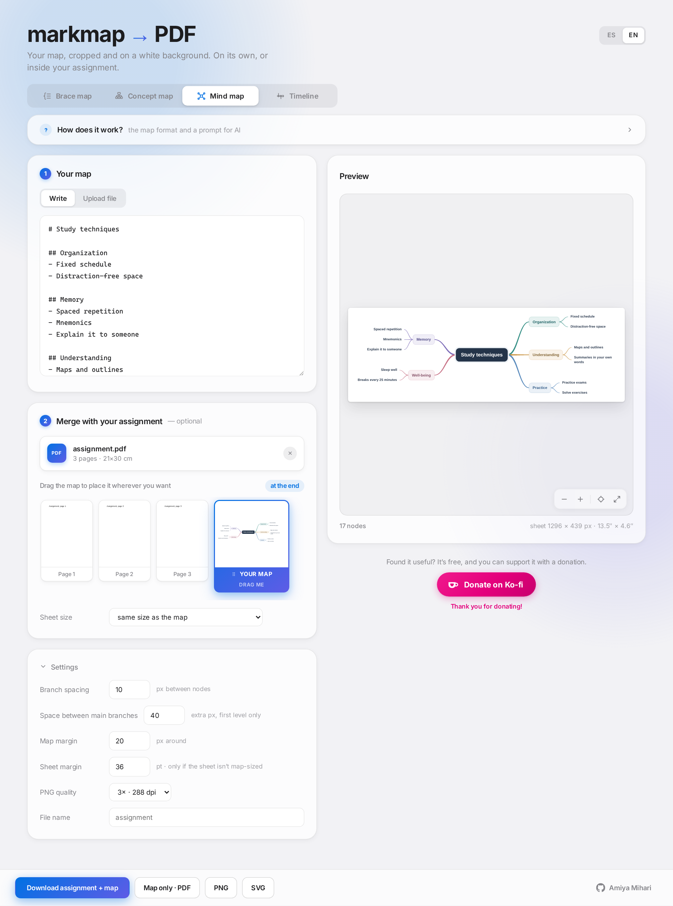
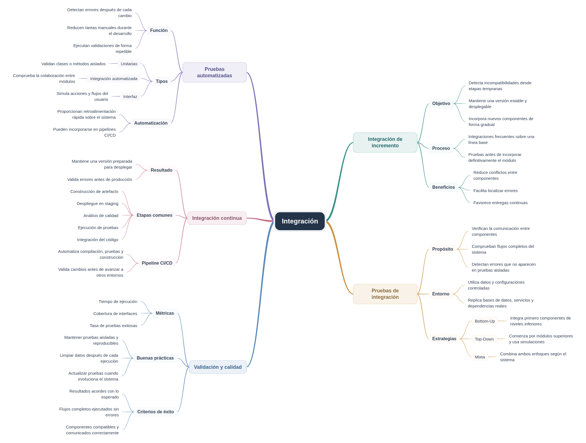
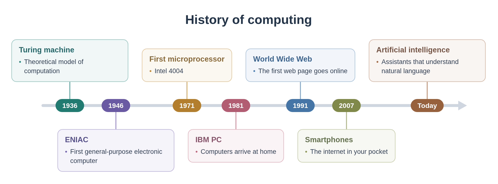

# markmap2pdf

Turn your Markdown notes into a **brace map, concept map, mind map or timeline**,
and get it as a **single-page PDF with a white background, cropped exactly and
without the watermark**. If you want, it drops the map straight into the PDF of
your assignment.

No more screenshots, online PDF editors or cropping by hand.

**Use it online, nothing to install:** <https://amiyamihari.github.io/Markmap-to-PDF/>



---

## Using the web interface

The interface runs **entirely in your browser**: there is no server and nothing
to install. Open it at <https://amiyamihari.github.io/Markmap-to-PDF/>, or on
your own computer:

```bash
git clone https://github.com/AmiyaMihari/Markmap-to-PDF.git
cd Markmap-to-PDF
bash start.sh
```

It opens at <http://127.0.0.1:8765> (`start.sh` only serves the `docs/` folder
with the Python that already comes with your system). From there:

* **Write your Markdown** and watch the map update as you type (or drop a `.md`
  file, or the `.html` you download from the [markmap REPL](https://markmap.js.org/repl)).
* **Drop the PDF of your assignment** to see its pages as thumbnails. Drag the
  map card between them to place it wherever you want (or use ← → with the card
  selected).
* Download **the merged PDF**, or just the map as **PDF / PNG / SVG**.

Below the title, **How does it work?** sums up the format the map understands
and has a ready-made prompt to ask an AI (ChatGPT, Claude, Gemini…) for the map.
There is no depth limit: after `###` you can keep going with `####`, `#####` and
`######` for sub-branches, and with indented bullets as deep as you like.
markmap drops bullets that come right before a sub-heading (`### A`, some bullets,
then `#### B`); the page fixes that and keeps them. If you paste the AI's answer
together with the ```` ``` ```` code-block marks, the page removes them. The
interface is available in **Spanish and English** (top right); your choice is
remembered.

The preview is **the real sheet**: it takes the exact proportions of the PDF you
will get and tells you its size, so you can see beforehand whether your map comes
out wide or tall. It has four buttons in the bottom-right corner:

| button | what it does |
|---|---|
| **−** / **+** | zoom out and in. As soon as you zoom (with these buttons or the wheel) or drag the map, the sheet stops cropping and the whole tray turns white, so the map can go anywhere |
| **center** (the crosshair) | fits the map back into the sheet, same as double-clicking it |
| **expand** (the arrows) | the map takes up the whole window, white edge to edge and without frames; `Esc`, the same button or a click on the border to go back |

### Brace map, concept map, mind map or timeline

You pick the map type above **How does it work?**. The same text works for all four:

| type | what it looks like |
|---|---|
| **Brace map** | left to right, with curved branches that open like braces (markmap's own layout) |
| **Concept map** | top to bottom, with boxes and right-angle lines, like an org chart |
| **Mind map** | the central idea in the middle and curved branches opening to the left and right |
| **Timeline** | the events in order along an axis, each with its date and a card with the details |

While you haven't written anything, the editor shows a different example for
each type, chosen to show off its shape (a classification, a tree of concepts, a
central idea with branches, dated events). As soon as you type or upload a file,
your text stays put even if you switch types or languages.

In the **concept map**, each main branch gets its own color, and the main
branches always stay side by side. Next to **Preview**, three buttons choose how
the rest is laid out; your choice is remembered:

| button | what it does |
|---|---|
| **Auto** | a small map is laid out side by side; if a big one would end up wider than a sheet, its groups fold into columns under their box until the proportions fit |
| **Open** | every branch side by side, even if the map gets wide |
| **Compact** | everything under the main branches hangs in columns, for a narrow, tall map |

The **mind map** splits the branches between the left and the right according to
how much room their content needs. Each subtree gets its own band, so nodes never
overlap and connections never cross other branches. The center stands out on a
dark background, the main topics sit on rounded cards with a soft color palette,
and the details read on white. Connections are curves that get thinner as they
go out, and single children sit closer to their parent. The same text always
gives the same map.



In the **timeline**, `#` is the title and each `##` (or each top-level bullet) is
an event, in the order you write them. If an event starts with a date, the date
goes on a colored label on the axis and the rest becomes the title of its card;
whatever goes under the event is the details. Dates are recognized like this:

| you write | date | title |
|---|---|---|
| `## 1969 — Moon landing` (or `–`, `:`, `\|`, ` - `) | 1969 | Moon landing |
| `## 1492 Columbus reaches America` | 1492 | Columbus reaches America |
| `## 1914-1918 World War I` | 1914-1918 | World War I |
| `## July 20, 1969: Apollo 11` | July 20, 1969 | Apollo 11 |
| `## 300 BC Founding` | 300 BC | Founding |
| `## 19th century` | 19th century | (details only) |
| `## Childhood` | (a dot on the axis) | Childhood |

Spanish works too (`## 1810 — Grito de Dolores`, `## Siglo XIX`,
`## 27 de septiembre de 1821: …`). The cards alternate on both sides of the axis.
Next to **Preview**, two buttons, **Horizontal** and **Vertical**, choose which
way the axis runs; your choice is remembered. With this type, the prompt in
**How does it work?** asks the AI for the events in order and with their dates.



Your map type is remembered for next time. The Python CLI only makes brace maps.

### Space between branches

In the **brace map**, markmap packs the tree as tightly as it can and big maps
come out crowded, so the map gets a bit of breathing room by default. You can
change it in **Settings**:

| setting | what it does |
|---|---|
| **Branch spacing** | vertical space between nodes, at every level (default 10 px; markmap uses 5) |
| **Space between main branches** | extra space only between the first-level branches, so they don't stick together (default 40 px) |

Set them to `5` and `0` if you prefer the map exactly as markmap draws it. What
you see in the preview is what you get in the PDF: it's the same code.

The same settings work in the other types: in the **concept map** they separate
the boxes and their groups; in the **mind map**, the nodes and the branches on
each side; in the **timeline**, the cards (branch spacing) and the events along
the axis (space between main branches).

Also, when a node has **a single child** (typically a term and its definition),
the line between them gets shorter. markmap puts all children at the same
distance; with several children the curves fill that space, but with just one it
left a long straight line and the text looked far away. The curves don't change.

You can drop files anywhere on the window: a `.pdf` is taken as your document
and a `.md` / `.html` as the map.

**Everything happens in your browser.** Your files never leave your computer and
only the final file is downloaded, so no stray files pile up in your folders.

In VS Code: `Ctrl+Shift+B` → "Abrir la interfaz web" (open the web interface).

### Sheet size when merging

| option | what it does |
|---|---|
| **same size as the map** (default) | the sheet is exactly as big as the map, with no margins |
| **same as your document** | the map's sheet matches the pages of your assignment (same size and orientation) |
| **landscape** | turns that sheet sideways so the map comes out bigger |

---

## Using the command line

Still available if you prefer it, or to process several maps at once. This one
does need a one-time install:

```bash
bash setup.sh
```

`setup.sh` creates the virtual environment in `.venv/`, installs
`requirements.txt` and downloads the Chromium that Playwright uses (~115 MB).
It's idempotent: if something breaks, just run it again.

```bash
python markmap2pdf.py map.md
python markmap2pdf.py ~/Downloads/markmap.html
python markmap2pdf.py maps/*.md          # in batch
```

It creates `map.pdf`, `map.png` and `map.svg` next to the input file. Try it with
the included map: `python markmap2pdf.py ejemplo.md`

| flag | what it does |
|---|---|
| `--out folder` | output folder |
| `--pad 40` | white margin around the map, in px (default 20) |
| `--scale 4` | PNG resolution (3 ≈ 288 dpi, default) |
| `--spacing 10` | vertical space between nodes, in px (default 10) |
| `--gap 40` | extra space between the main branches, in px (default 40) |
| `--no-png` / `--no-svg` / `--no-pdf` | skip formats |

---

## The environment turns on by itself

**In VS Code you don't have to activate anything.** `.vscode/settings.json` sets:

* `python.defaultInterpreterPath` → `.venv/bin/python`
* `python.terminal.activateEnvironment` → `true`
* the project's integrated terminal uses **bash**

When you open the folder, every new terminal already has `.venv` activated
(you'll see `(.venv)`). It needs the **ms-python.python** extension, already
recommended in `.vscode/extensions.json`.

**Outside VS Code**, in bash:

```bash
source .venv/bin/activate      # by hand
# ...or without activating anything:
.venv/bin/python markmap2pdf.py map.md
```

<details>
<summary>Optional: let bash activate the venv when you enter the folder</summary>

Paste this **once** at the end of your `~/.bashrc`:

```bash
# auto-activate .venv when entering a folder that has one
_auto_venv() {
  if [[ -n "$VIRTUAL_ENV" && "$PWD" != "$(dirname "$VIRTUAL_ENV")"* ]]; then
    deactivate 2>/dev/null
  fi
  if [[ -z "$VIRTUAL_ENV" ]]; then
    local d="$PWD"
    while [[ "$d" != "/" ]]; do
      if [[ -f "$d/.venv/bin/activate" ]]; then
        source "$d/.venv/bin/activate"
        break
      fi
      d="$(dirname "$d")"
    done
  fi
}
PROMPT_COMMAND="_auto_venv${PROMPT_COMMAND:+; $PROMPT_COMMAND}"
```

Then `source ~/.bashrc`.
</details>

---

## How the cropping works

Both the page and the CLI draw the map separately, at scale 1 and without zoom,
and then:

1. remove the zoom `transform` that d3 applies to the `<g>`,
2. compute the real `getBBox()` of the content and rewrite the `viewBox` with that size + margin,
3. export with a sheet identical to the content → **one page, zero margins to crop**.

The PDF is vector: the text can be selected and doesn't pixelate when you zoom
in. When merged with your assignment, the map is scaled and centered on the
sheet **without losing quality** (it stays vector, it isn't turned into an image).

On the page, `docs/motor.js` builds the PDF with [pdf-lib](https://pdf-lib.js.org/):
it reads from the browser where each letter ended up and writes it as real text.
It uses Helvetica and Courier (every PDF reader has them) and, only if the map
has arrows, Greek letters or other symbols, downloads the DejaVu Sans font for
them. If the map has emojis or images, which no PDF font has, that PDF comes out
as a 288 dpi image so nothing gets lost.

---

## Bonus for Word

Word 2016+ inserts **native SVG** (`Insert > Pictures > This device > map.svg`).
It looks perfect at any size and weighs almost nothing. If your Word supports it,
use the `.svg`; if not, the 3× `.png` is the next best option. The merged PDF is
handy when you hand in the assignment as a PDF.

---

## Project structure

For how it works inside (the rendering and export pipeline, the drawer contract,
and how to add a new map type), see [ARCHITECTURE.md](ARCHITECTURE.md).

| file | what it is |
|---|---|
| `docs/index.html` | the interface |
| `docs/app.js` | what the interface does: preview, files, downloads |
| `docs/i18n.js` | the texts in Spanish and English |
| `docs/concept.js` | the concept map (top to bottom) |
| `docs/mindmap.js` | the mind map (curved branches on both sides of the center) |
| `docs/timeline.js` | the timeline (dated events along an axis) |
| `docs/motor.js` | the in-browser exporter: SVG, PNG, PDF and merging with the assignment |
| `docs/spacing.js` | the space between branches (shared by the page and the CLI) |
| `markmap2pdf.py` | the CLI (renders and crops with Chromium) |
| `start.sh` | opens the interface locally |
| `setup.sh` | installs what the CLI needs |
| `ejemplo.md` | sample map |
| `tests/concept_browser.py` | concept map layout and layout-button tests |
| `tests/mindmap_browser.py` | mind map layout and mode-switching tests |
| `tests/timeline_browser.py` | timeline date, layout and direction tests |
| `ARCHITECTURE.md` | how the code works inside |
| `TODO.md` | ideas waiting to be built |
| `AGENTS.md` | conventions for AI agents (and humans) working on the repo; `CLAUDE.md` points to it |
| `LICENSE` | the license: GPL-3.0 |
| `.gitattributes` | tells GitHub that `docs/` is code, so the language stats are right |

The code comments are in Spanish. The previous version, with the interface
served by Python (FastAPI + Chromium), is still on the
[`version-python`](https://github.com/AmiyaMihari/Markmap-to-PDF/tree/version-python) branch.

---

## Google Colab

Only if you need the CLI on another machine. Installing Chromium (~1–2 min) is
repeated **every session**.

```python
!pip -q install playwright
!playwright install --with-deps chromium
!git clone -q https://github.com/AmiyaMihari/Markmap-to-PDF.git
%cd Markmap-to-PDF
```

```python
from google.colab import files
files.upload()          # upload your map.md
!python markmap2pdf.py map.md
files.download('map.pdf')
```

---

## Troubleshooting

* **The map comes out empty** → usually it's markmap's CDN. Download the HTML
  from the REPL and upload it; that one doesn't depend on the CDN.
  (Note: the right browser build is `dist/browser/index.iife.js`;
  `dist/browser/index.js` is ESM and doesn't define any global.)
* **A node looks cut off** → raise the margin in *Settings* (or `--pad 60` in the CLI).
* **Gray or dark background** → the CLI forces `color_scheme="light"`; if your
  HTML has a dark theme embedded, export it from the REPL with the light theme
  (the little sun ☀).
* **`Address already in use`** → there's already an instance open, or use
  another port: `bash start.sh 9000`.
* **`playwright: command not found`** → you're not in the venv: `bash setup.sh`.

---

## Testing the mind map and the timeline

After `bash setup.sh`, run:

```bash
.venv/bin/python tests/concept_browser.py
.venv/bin/python tests/mindmap_browser.py
.venv/bin/python tests/timeline_browser.py
```

Each test opens a headless Chromium and a temporary local server. They check for
overlaps, fitting, deterministic layout, long texts, spacing settings and
switching between types, that the map type is kept after reloading, and that
there are no JavaScript errors. The concept map test runs 81 combinations of
content, layout and spacing, and the layout buttons; the mind map test, 21
combinations of content and spacing; the timeline test, 12 date formats, 42
combinations of content, direction and spacing, and the direction buttons. They need an internet
connection to load the CDN dependencies the page uses.

---

## Requirements

Python 3.9+ (tested on 3.14). `setup.sh` installs everything else.

---

## Support the project

It's free and will stay free. If it saved you time, you can support it with a
donation on [Ko-fi](https://ko-fi.com/W7B72558PR). Thank you for donating!

---

## License

**GPL-3.0 or later** · © 2026 Amiya Mihari. The full text is in [`LICENSE`](LICENSE).

In short: you can use, study, modify and share this project, even charge for
distributing it. The condition is that any version you share, modified or not,
must carry the same license and its source code. That way every copy stays free
and nobody can close it.

### Credits

The page uses these libraries. They are downloaded from the CDN when you open it,
and each one keeps its own license:

| library | used for | license |
|---|---|---|
| [markmap](https://github.com/markmap/markmap) (© 2020 Gerald) | turning Markdown into a tree and drawing the brace map | MIT |
| [d3](https://d3js.org) | drawing the maps and zooming | ISC |
| [pdf-lib](https://pdf-lib.js.org) and [fontkit](https://github.com/Hopding/fontkit) | creating and merging the PDFs | MIT |
| [pdf.js](https://mozilla.github.io/pdf.js/) | reading the PDF of your assignment | Apache-2.0 |
| [DejaVu Sans](https://dejavu-fonts.github.io) | symbols that Helvetica doesn't have | DejaVu's free font license |
| [KaTeX](https://katex.org) (CLI only) | formulas | MIT |
| [Playwright](https://playwright.dev) (CLI only) | running Chromium to export | Apache-2.0 |

The text styles inside the nodes (bold, code, links) follow markmap's.
